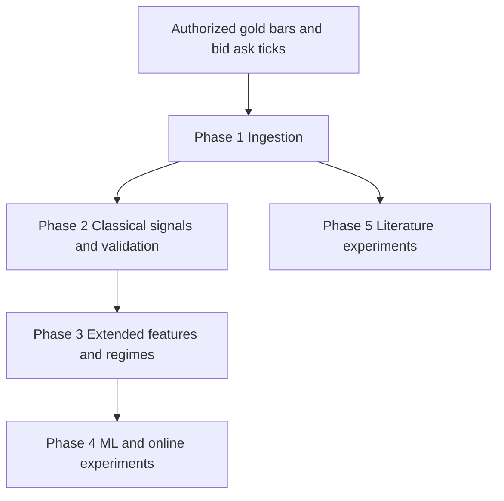

# Gold Strategy Validation

Gold strategy research with signal ensembles, walk-forward validation, machine-learning comparisons and literature-driven experiments.

## Research workflow



The diagram describes the research components, not verified performance or an automated live-trading service.

## Setup

Use Python 3.10 or newer for modern source syntax. Dependencies are inferred from the included source and are not a tested version lock.

```powershell
python -m venv .venv
.venv\Scripts\python -m pip install -r requirements.txt
```

On macOS/Linux use `.venv/bin/python`. Review local input paths before running scripts; some scripts perform work at import time. Clean installation and full experiments have not been verified for this release.

## Data and run order

Place authorized HistData NT inputs under `input_Data/`: M1 CSVs matching `DAT_NT_XAUUSD_M1_*.csv` and bid/ask tick ZIPs matching the patterns in `phase1_ingest.py`. Inputs use the source US/Eastern time convention. Preserve and independently check the timestamp conversions before interpreting results.

The core starting sequence is `phase1_ingest.py`, `phase2a_features.py`, `phase2b_signals.py`, `phase2c_strategy.py`, `phase2d_walkforward.py`, then `phase2e_oos.py`. Prepared bar and feature files go to `clean_Data/`. Review phase 3 and 4 source inputs before extending the sequence: those stages branch into several experiments rather than one automatic runner.

Run scripts in `phase5_literature/` from that directory where relative result paths are used. These experiments depend on cleaned gold data and, for some variants, derived tick grids and outputs of earlier literature scripts. `build_mid5s.py` prepares a finer mid-price grid from local tick archives.

The publication copy replaces hardcoded gold workspace paths with paths relative to the source files. MT5 live executors, launchers, account state and measured result files are not included.

## Source guide

| File | Purpose from source documentation |
|---|---|
| `phase1_ingest.py` | Phase 1 — mega ingest for XAUUSD research. |
| `phase2_common.py` | Shared utilities for Phase 2: data loading, metrics, and the trade-level backtest engine. |
| `phase2_plots.py` | Phase 2 — equity-curve plots (in-sample + OOS, per-signal, drawdown). |
| `phase2a_features.py` | Phase 2a — Build the feature / regime matrix on the 5-min grid. |
| `phase2b_signals.py` | Phase 2b — Single-signal backtests on the 5-min grid. |
| `phase2c_strategy.py` | Phase 2c — Ensemble strategy with risk governor. |
| `phase2d_walkforward.py` | Phase 2d — Walk-forward hyperparameter search + Monte Carlo pass-probability. |
| `phase2e_oos.py` | Phase 2e — Out-of-sample (OOS) test on the held-out last-20% of data. |
| `phase3_features.py` | Phase 3 — Extended feature matrix with literature-recommended regime & volatility layers. |
| `phase3_plots.py` | Phase 3 equity curve vs Phase 2 best. |
| `phase3_strategy.py` | Phase 3 — Argos v2: lit-upgraded signals + friction-adjusted Kelly sizing + CPD gating. |
| `phase3_walkforward.py` | Phase 3 — Walk-forward optimization with the extended signal set. |
| `phase4_backtest.py` | Phase 4d — Does the ML layer actually improve the strategy? |
| `phase4_bias_fix.py` | Phase 4g / Step 1 — Diagnose and fix the Phase-3 long bias. |
| `phase4_brain.py` | Phase 4i — "The brain": a memory-conditioned trade selector, 60/30/10. |
| `phase4_brain_plots.py` | Phase 4j — Equity curves for the 60/30/10 brain, all segments in one image. |
| `phase4_dmn.py` | Phase 4e — Deep learning: Deep Momentum Network (LSTM trained on Sharpe ratio). |
| `phase4_features.py` | Phase 4b — ML feature set definition and causal derived features. |
| `phase4_labels.py` | Phase 4a — Supervised labels for the ML layer. |
| `phase4_memory.py` | Phase 4h / Steps 2-4 — The memory engine ("the brain"). |
| `phase4_ml.py` | Phase 4c — Supervised models with purged, expanding-window walk-forward CV. |
| `phase4_plots.py` | Phase 4f — Equity curves: Phase 2 (classical) vs Phase 3 (lit-upgraded) |
| `phase4b_online_brain.py` | Phase 4b — Online brain, concurrent entries, trade-frequency sweep. |
| `phase4b_plots.py` | Phase 4b — trade-frequency sweep visualisation. |
| `phase5_literature/build_mid5s.py` | Build a 5-second last-quote mid-price grid from HistData bid/ask tick zips (paper 44 needs it). |
| `phase5_literature/common.py` | Phase 5 — shared engine for the literature replication study. |
| `phase5_literature/s01_f2f.py` | Paper 11 — "Forecast-to-Fill: Benchmark-Neutral Alpha ... in Gold" (daily bars). |
| `phase5_literature/s02_cubic_tsmom.py` | Paper 46 — "Trends, Reversion, and Critical Phenomena": E[R_{t+1}] = b*phi + c*phi^3, |
| `phase5_literature/s03_hmm.py` | Paper 18 — "Hidden Markov Models Applied To Intraday Momentum Trading With Side Information". |
| `phase5_literature/s04_drift_burst.py` | Paper 44 — "The drift burst hypothesis" (Christensen, Oomen, Reno). |
| `phase5_literature/s05_hurst_q.py` | Paper 30 — "Optimizing Returns Using the Hurst Exponent and Q Learning on Momentum and |
| `phase5_literature/s06_ou_tvar.py` | Paper 40 — "Speculative Futures Trading under Mean Reversion" (Leung, Li, Li, Zheng) |
| `phase5_literature/s07_tats_xgb.py` | Paper 45 — TATS: a binary TREND PREDICTOR (XGBoost was the best on gold: 58.7% test accuracy |
| `phase5_literature/s08_dmn_cpd.py` | Paper 39 — "Slow Momentum with Fast Reversion: Deep Learning and Changepoint Detection". |
| `phase5_literature/s09_rl_positional.py` | Paper 9 — "Deep Reinforcement Learning with Positional Context for Intraday Trading" |
| `phase5_literature/s10_hybrids.py` | Hybrids. Every rule below is fixed a priori from the papers or uses only past data. |
| `phase5_literature/s11_report.py` | Final equity curves (small multiples by paper family + hybrids) and the summary table. |
| `phase5_literature/s12_h1_online_learner.py` | H1 (daily F2F regime x hourly cubic) with a trade-by-trade ONLINE learner, 60:30:10 split. |
| `phase5_literature/s13_switch.py` | Switch-case study: when should we trade H1, the policy-gradient agent, the H4 ensemble or |
| `phase5_literature/s14_live_sizing.py` | What H1 + learner looks like on a small MT5 account: 0.01-lot (1 oz) minimum size, |

## Security and publication scope

Only explicitly selected research source and newly prepared documentation are published. Populated environment files, sessions, private keys, account state, raw data, model binaries, historical outputs, paper PDFs, caches and local Git history are excluded. Original local project files are unchanged. Do not publish generated output without checking it for personal information and data redistribution rights.

Selected Python source passed syntax checks. Selected text was screened for credential patterns and known local credential values. These checks are not a security certification; dependency vulnerabilities, full execution and broker integration were not tested. No live orders or broker login were performed.

## Research limitations

No historical performance headline is asserted or independently reproduced here. Review sample selection, holdout reuse, look-ahead risk, costs, spread, slippage and sizing before interpreting results. Source comments reflect the original experiments and are not independently verified claims. Research output does not establish deployment readiness.

## License

No open-source license has been assigned. Public visibility alone does not grant general reuse or redistribution rights.
